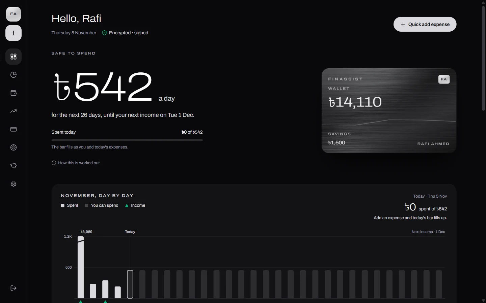
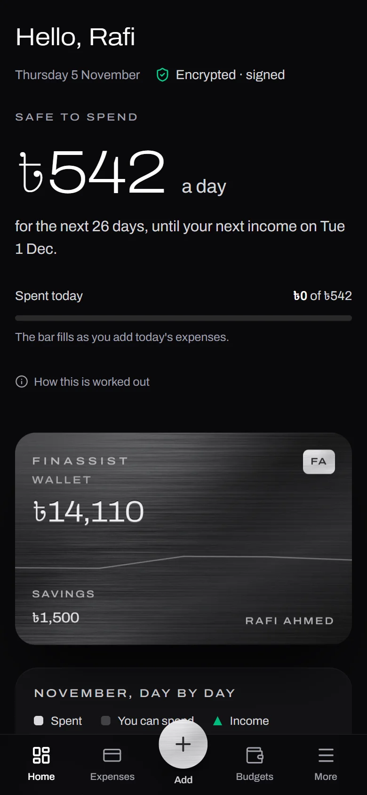
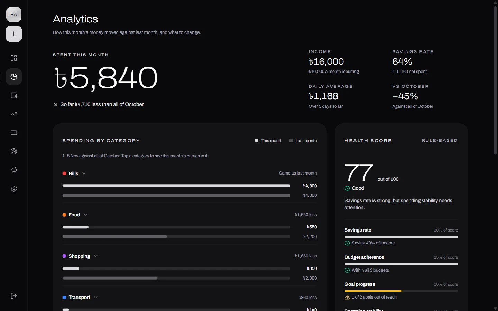
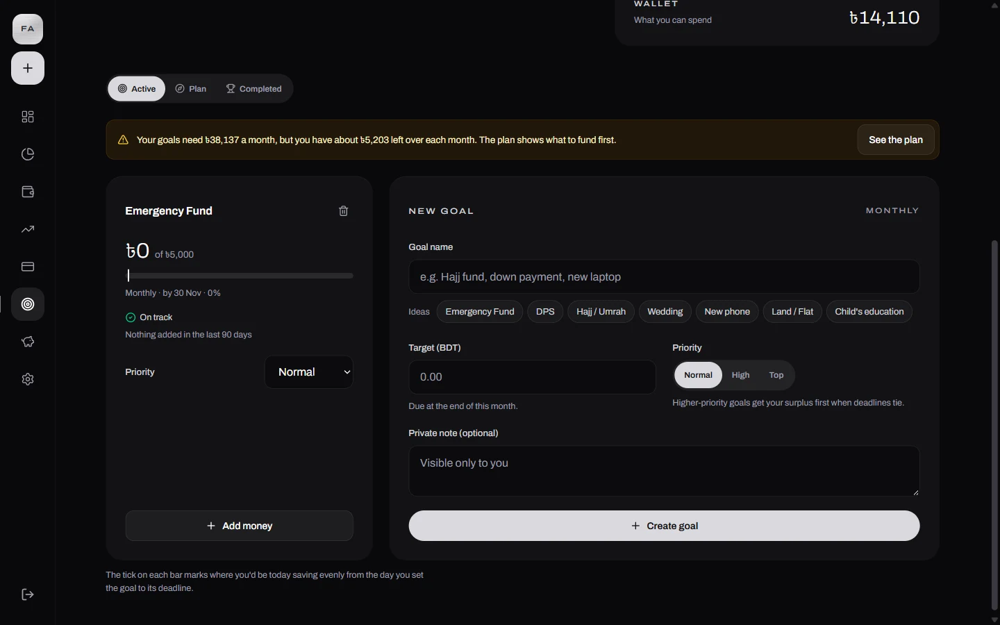
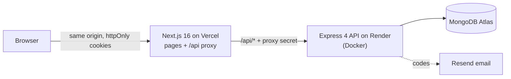

# FinAssist

**A personal finance app for students: what's safe to spend each day until the next
allowance, where the month's money went, and whether savings goals are actually
reachable.**

[](https://github.com/AQibARman28/FinAssist/actions/workflows/ci.yml)
[](LICENSE)

**Live app:** <https://finassist101.vercel.app>. Create an account to try it. The API
runs on a free server that sleeps when idle, so the first request can take up to a
minute; the app says so while it waits.



<table>
  <tr>
    <td width="32%"></td>
    <td><br><br>
        </td>
  </tr>
</table>

## What it does

- **Safe to spend.** The wallet divided over the days until the next recurring
  income, set at the start of each day, with the pay period drawn day by day.
- **Expenses in one line.** Quick add reads text like `lunch 2*175 food` or
  `rickshaw 60 yesterday`: amount, simple maths, a category word and a date.
- **Budgets per category and month**, each measured against an even pace through the
  month, with a copy-from-last-month shortcut.
- **Income**, one-off or repeating weekly, fortnightly, monthly or yearly.
- **A wallet and a separate savings account**, with a month-end prompt for last
  month's leftover.
- **Savings goals with a planner.** Each goal is on track, behind or out of reach,
  judged against the student's real monthly surplus and the money already left over.
  The plan suggests how to split the surplus across goals, never more than a goal
  still needs, and records nothing until the student confirms.
- **Analytics:** this month against last by category, unusual spending, recurring
  income, rule-based tips, and a five-factor financial health score.
- **Account security:** two-factor sign-in (authenticator app plus recovery codes),
  email-verified password reset and email change, and a choice of nine currencies.
- **Installable** as an app on phones and desktops (PWA).

The tips and the health score are rule-based; no external AI service is called.

## How it's built



| | |
|---|---|
| **Web** (`views/`) | Next.js 16 (App Router), React 19, TypeScript, Tailwind CSS 4, Framer Motion, Zustand, date-fns, chrono-node. Hand-built SVG charts, no chart library. |
| **API** (`Backend/`) | Node 22, Express 4, Mongoose 7, zod (a strict schema on every route), Argon2id, speakeasy (TOTP), helmet, rate limiting. |
| **Infrastructure** | Vercel (web), Render (API, Docker), MongoDB Atlas, Resend; a `docker-compose.yml` for self-hosting. |
| **Quality** | About 400 API tests (Jest, in-memory MongoDB) and 175 web tests (node:test). CI type-checks, lints, tests, builds and audits dependencies on every push. |

### Security

The app holds financial data, so security was designed in rather than added on:

- **Sessions:** httpOnly, SameSite=Strict cookies. A 15-minute access token, plus a
  single-use refresh token that rotates on every refresh, with reuse detection. No
  token is ever readable by page JavaScript.
- **Requests:** CSRF protection through a required header on every state-changing
  call. The Next proxy signs each API call with a shared secret, and the API refuses
  anything that didn't come through it.
- **Data at rest:** every user has their own AES-256-GCM data key, wrapped by a
  rotatable master key ring. Each encrypted value is bound to its owner and field.
- **Integrity:** records are ECDSA-signed on create and update, and a record whose
  signature fails is flagged on read ("Signed" beside each entry).
- **Sign-in:** a throttle that treats existing and unknown emails identically,
  breached-password screening, and re-authentication for password or email changes.

The full write-ups: [October 2026 hardening](docs/security/HARDENING-2026-10.md)
(28 findings, each closed test-first), [key management](docs/security/key-management.md)
and [the ECDSA decision](docs/decisions/SEC-1-ecdsa.md).

## Run it locally

You need Node 22 and MongoDB 8. Full steps are in [RUNNING-LOCALLY.md](RUNNING-LOCALLY.md):

```bash
cd Backend && npm install && cp .env.example .env   # then fill in the three secrets
npm run dev                                          # API on :5000
cd ../views && npm install && cp .env.local.example .env.local
npm run dev                                          # app on http://localhost:3000
```

Tests:

```bash
cd Backend && npx jest
cd ../views && npm test && npx tsc --noEmit && npm run lint
```

Deploying your own copy for free (Vercel, Render, Atlas) is covered in
[DEPLOY.md](DEPLOY.md).

## Repository map

```
Backend/            Express API: app.js builds the app, index.js boots it
  controllers/ routes/ models/ validators/ middleware/
  services/         pure logic: balance, cash flow, goal planning, health score
  utils/            encryption, signing, sessions, mail, config checks
  tests/            Jest suites (controllers, HTTP chain, pure services)
  legacy_crypto/    from-scratch crypto lab (course work), never imported by the API
views/              Next.js app
  src/app/          routes: (auth) sign-in pages, dashboard/*
  src/components/   UI; dashboard/ui.tsx holds the shared pieces
  src/lib/          data, maths and parsing, unit-tested
  DESIGN.md         the visual system
  PRODUCT.md        who it's for and what it must never claim
docs/               security write-ups, a design decision, sprint records
.github/workflows/  CI, and a keep-alive ping for the free API server
```

## License

[MIT](LICENSE)
